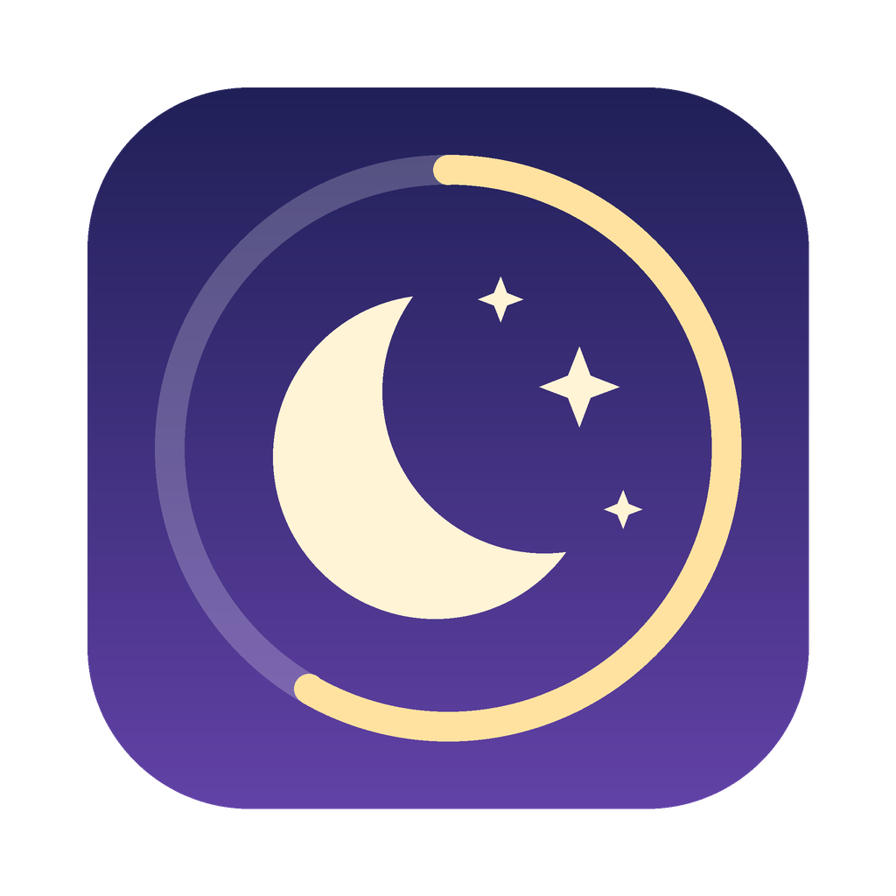

**English** | [Українська](README.uk.md)

# Sleep Timer for macOS

<p align="center">
  
</p>

A small Mac app that stops playback after a set time. Start YouTube or Twitch before bed, click 25 minutes, and the video pauses on its own.

Written in Swift (AppKit) in a single file. No Xcode, no third-party dependencies.

## Features

- A floating panel with time presets: 15, 25, 35, 45, 60 or 90 minutes.
- After you pick a time, the panel collapses and the countdown continues in the menu bar next to a moon icon.
- Click the menu bar icon or the Dock icon to bring the panel back and cancel the timer if needed.
- The Dock icon shows the minutes remaining.
- Three actions when time is up (your choice is remembered):
  - **Pause**: pauses playback, like the Stop Playing option of the built-in Clock timer. It sends a real pause command, not a toggle, so a video that is already paused will not start playing.
  - **Close**: quits browsers and players (Chrome, Safari, Firefox, Arc, Edge, Brave, Spotify, Music, TV).
  - **Sleep Mac**: puts the computer to sleep.
- Follows the system light or dark appearance.

## Download

The latest build (Apple Silicon) is on the [Releases page](https://github.com/Poohovskiy/sleep-timer-macos/releases/latest). Unzip it, drag `SleepTimer.app` to Applications, then run this in Terminal:

```bash
xattr -dr com.apple.quarantine /Applications/SleepTimer.app
```

The command is needed because the app is not signed with a paid Apple developer certificate, so macOS blocks downloaded copies. As an alternative, open System Settings, Privacy & Security, and click "Open Anyway".

## Build from source

Requires macOS 12 or later and Command Line Tools (`xcode-select --install`).

```bash
git clone https://github.com/Poohovskiy/sleep-timer-macos.git
cd sleep-timer-macos

bash build.sh

mv SleepTimer.app /Applications/
open /Applications/SleepTimer.app
```

`build.sh` compiles `SleepTimer.swift`, builds the icon from `icon.png`, assembles `SleepTimer.app` and signs it ad hoc (no developer account needed). A copy you build yourself needs no `xattr` step.

To start the app at login, add it in System Settings, General, Login Items.

## Project structure

| File | Purpose |
|---|---|
| `SleepTimer.swift` | the whole app |
| `build.sh` | builds the `.app`, creates the icon and signs it |
| `icon.png` | 1024x1024 icon |

## Good to know

- **Pause** relies on an undocumented system command (MediaRemote). Apple may change or restrict it in future macOS versions. If pause stops working, use **Close** or **Sleep Mac**.
- **Close** asks apps to quit. If an app has unsaved work, it may show a confirmation dialog that nobody will answer at night.
- The prebuilt release is for Apple Silicon only. On an Intel Mac, build from source.

## License

No license has been chosen yet. Add a `LICENSE` file (for example MIT) before reusing the code.
