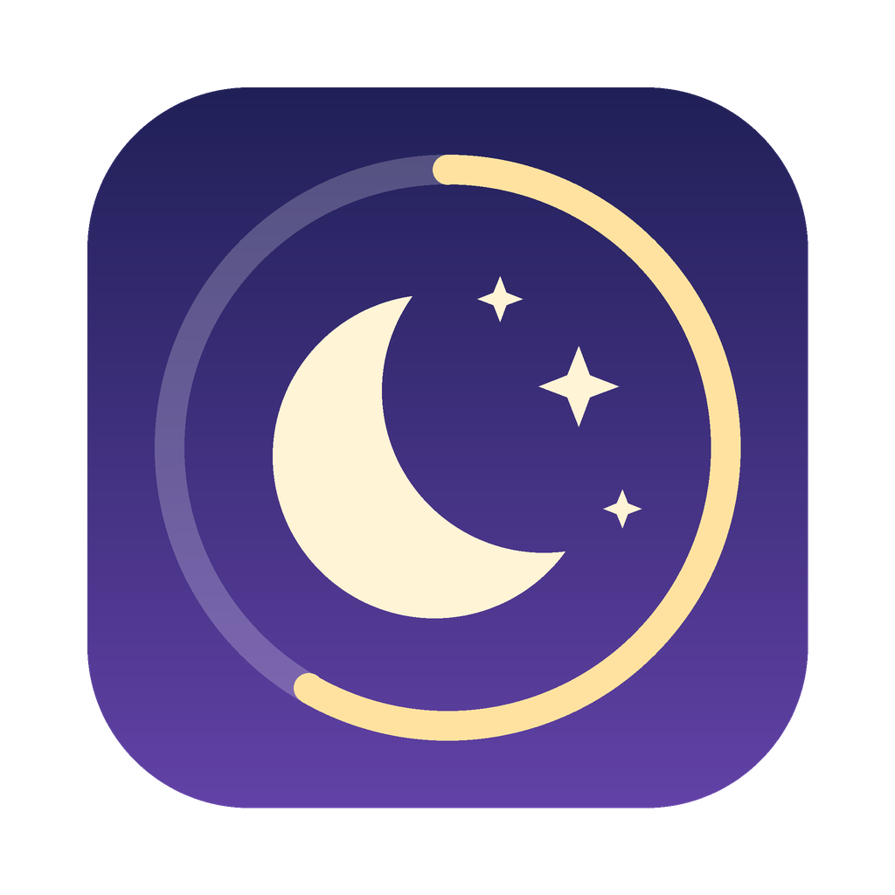

[English](README.md) | **Українська**

# Таймер сну для macOS

<p align="center">
  
</p>

Невеликий застосунок для Mac, який вимикає відтворення через заданий час. Вмикаєш YouTube чи Twitch перед сном, натискаєш на потрібний час, і за 25 хвилин відео саме стає на паузу.

Написаний на Swift (AppKit) в одному файлі, без Xcode і сторонніх залежностей.

## Можливості

- Плаваюча панелька з вибором часу: 15, 25, 35, 45, 60 або 90 хвилин.
- Після вибору часу панелька згортається, а відлік іде в рядку меню поруч зі значком місяця.
- Клік по значку в рядку меню або по іконці в Dock знову відкриває панельку. Звідти таймер можна скасувати.
- На іконці в Dock показується, скільки хвилин залишилось.
- Три режими на момент, коли час вийде (вибір запам'ятовується):
  - **Пауза**: ставить відтворення на паузу, як стандартний таймер у macOS. Це саме команда паузи, а не перемикач, тому відео, що вже стоїть на паузі, не запуститься.
  - **Закрити**: закриває браузери та плеєри (Chrome, Safari, Firefox, Arc, Edge, Brave, Spotify, Музика, TV).
  - **Сон Mac**: присипляє комп'ютер.
- Тема світла чи темна підлаштовується під системну.

## Вимоги

- macOS 12 або новіша.
- Command Line Tools (потрібен компілятор `swiftc`). Встановлюються командою `xcode-select --install`.

## Збірка та встановлення

```bash
git clone <адреса цього репозиторію>
cd <папка репозиторію>

bash build.sh

mv SleepTimer.app /Applications/
xattr -dr com.apple.quarantine /Applications/SleepTimer.app
open /Applications/SleepTimer.app
```

Скрипт `build.sh` компілює `SleepTimer.swift`, створює іконку з `icon.png`, складає `SleepTimer.app` та підписує його ad-hoc підписом (без акаунта розробника).

Щоб застосунок стартував разом із системою, додай його в Системні параметри → Загальні → Елементи входу. Щоб кнопка була завжди під рукою, правий клік по іконці в Dock → Параметри → Залишити в Dock.

## Структура

| Файл | Призначення |
|---|---|
| `SleepTimer.swift` | увесь код застосунку |
| `build.sh` | збірка `.app`, створення іконки та підпис |
| `icon.png` | іконка 1024×1024 |

## Важливо знати

- Режим **Пауза** користується недокументованою системною командою MediaRemote. Apple може змінити або обмежити її в майбутніх версіях macOS. Якщо пауза раптом перестане працювати, обирай режим **Закрити** або **Сон Mac**.
- Застосунок не має підпису розробника, тому при першому запуску macOS може його заблокувати. Команда `xattr` у розділі про збірку знімає це блокування.
- Режим **Закрити** просить програми завершити роботу. Якщо в якійсь із них є незбережена робота, вона може показати запит на підтвердження, який уночі ніхто не підтвердить.

## Ліцензія

Ліцензію ще не обрано. Перед публікацією додай файл `LICENSE` (наприклад, MIT).
